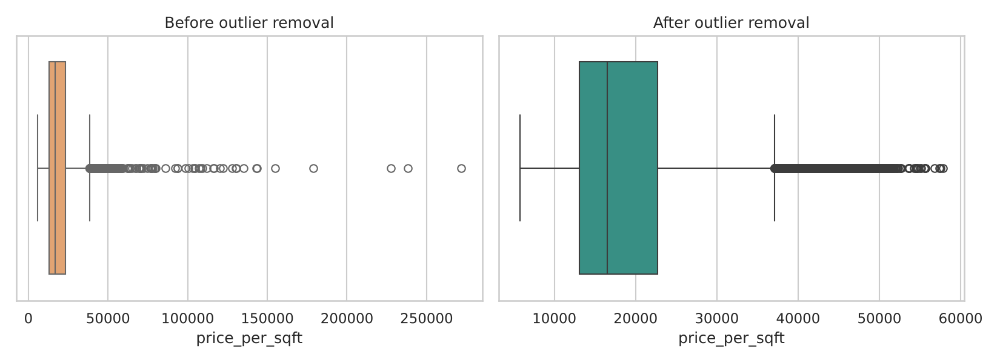
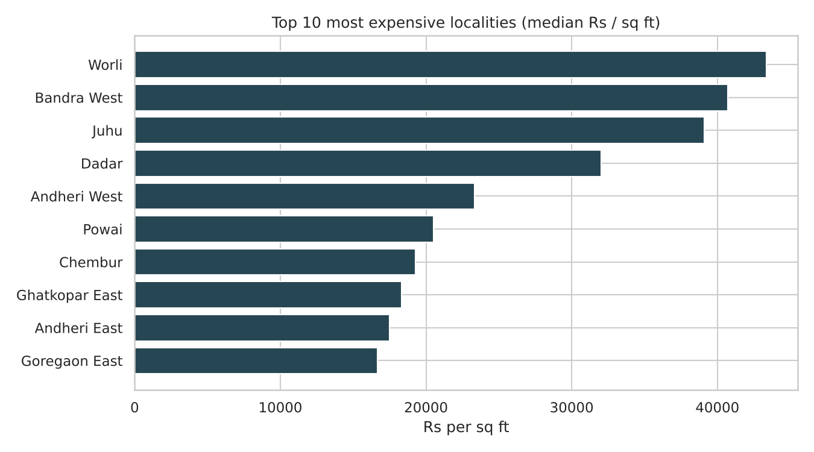
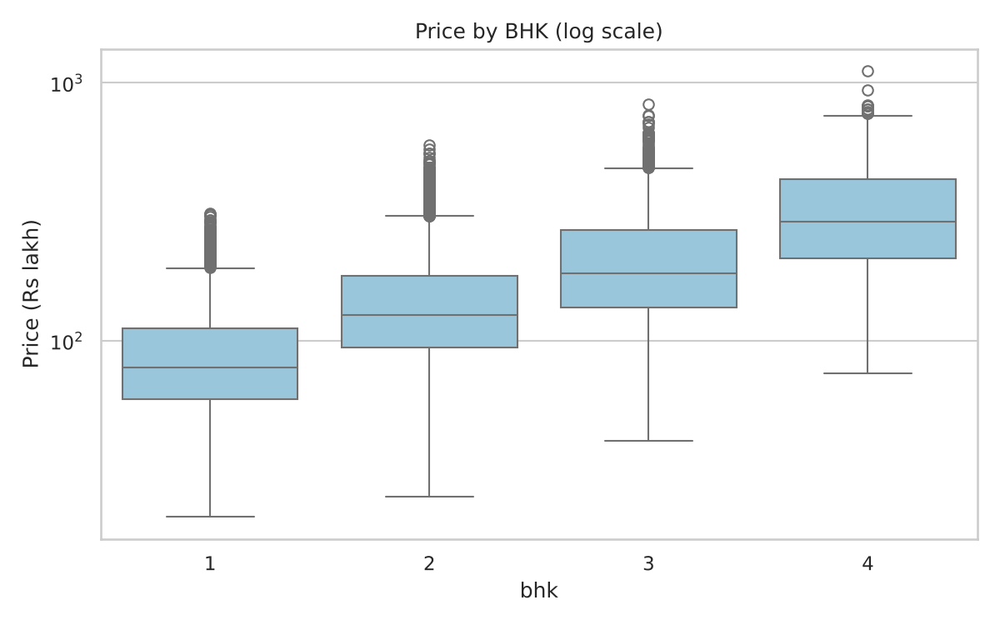
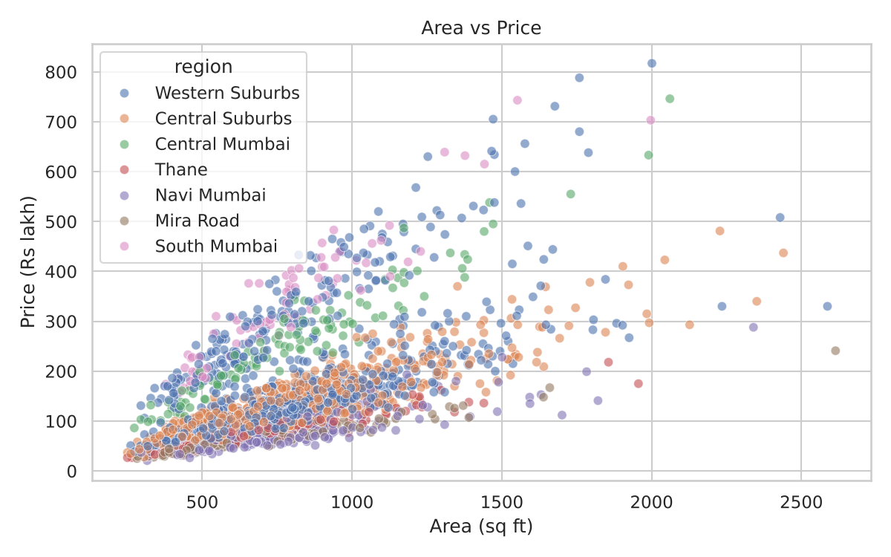
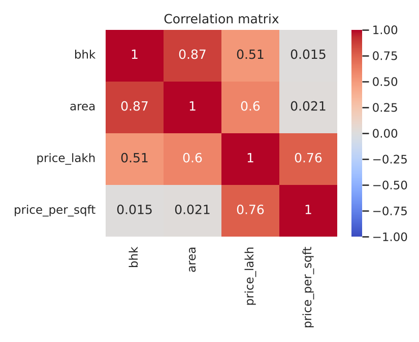

# Mumbai Housing Price Analysis

**Level:** Intermediate  
> Which Mumbai localities are priciest, which give the best value, and how well can price be predicted?

> **Before you publish:** this repo ships with a *synthetic sample dataset* in the same format as the real one so everything runs out of the box. Download the real dataset (see below), put it at `data/mumbai_house_prices.csv`, re-run, and replace the Key Insights section with your real numbers. Then delete this note.

## Business questions

- Which locality is most expensive?
- What is the price per square foot by locality?
- How does BHK affect price?
- How does area affect price?
- Which are the best-value locations?

## Dataset

- Mumbai House Prices (Kaggle) - columns `bhk, type, locality, area, price, price_unit, region, status, age`
- Expected location: `data/mumbai_house_prices.csv` (search the dataset name on Kaggle to download it)
- If the file is missing, `generate_data.py` creates a sample with the same columns automatically.

## Skills demonstrated

Data cleaning (price units in Lakh/Crore), outlier removal (IQR per locality), correlation analysis, linear regression and random forest, Power BI

## Project structure

```
README.md
analysis.ipynb         notebook (cells run top to bottom)
analysis.py            same analysis as a script
cleaned_dataset.csv
images/               charts used in this README
data/                 raw data goes here
generate_data.py      sample-data generator
requirements.txt
powerbi/              dashboard guide + export for Power BI
```

## How to run

```bash
pip install -r requirements.txt
python analysis.py             # or: jupyter notebook analysis.ipynb
```

Power BI: `powerbi/DASHBOARD_GUIDE.md` has step-by-step layout and DAX measures; the notebook exports `powerbi/powerbi_data.csv`.

## Key insights

_Run the analysis and paste the five printed insights here, each with a recommendation. Example format:_

1. **Finding with a number** - e.g. "Month-to-month contracts churn at 3x the rate of two-year contracts."
   - *Recommendation:* what the business should do about it.
2. ...

## Visualizations







## Interview talking points

- Why outliers were removed per locality rather than globally (a Worli flat is not an outlier in Mumbai, but it is in Kharghar).
- Why I predicted log(price) and what MAE means in lakh for a buyer.

## Resume bullet (fill in your numbers)

> Analysed [N]+ Mumbai property listings; removed outliers, built a price-prediction model (R2 = [x]) and a Power BI dashboard ranking localities by price per sq ft.

## Tech stack

Python, Pandas, NumPy, Matplotlib, Seaborn, scikit-learn, Jupyter
